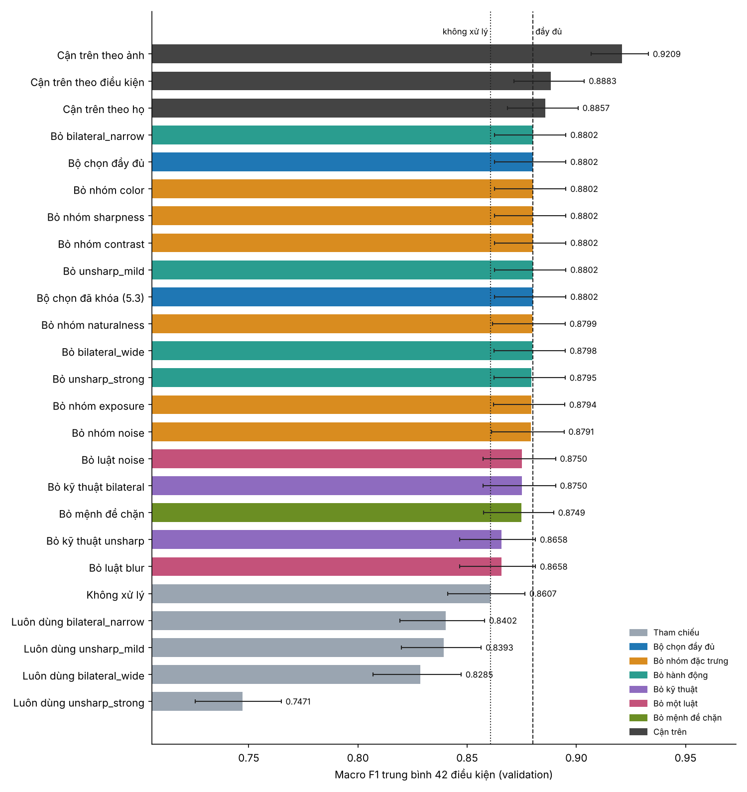
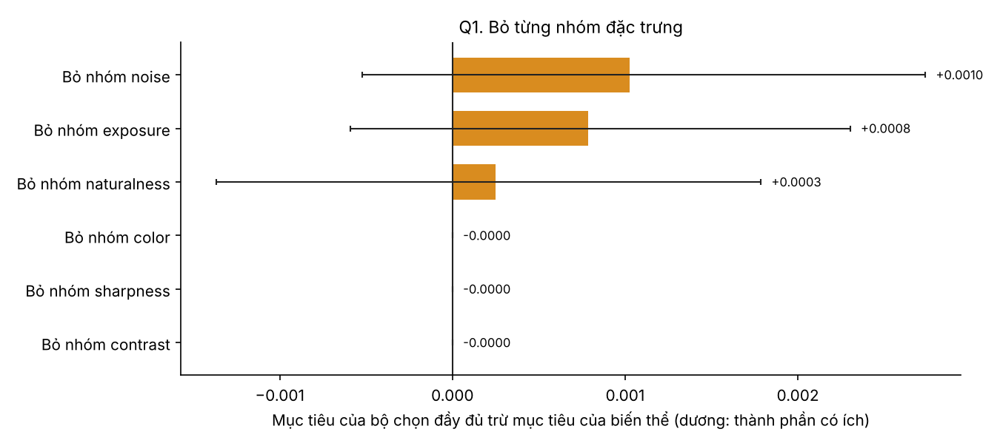
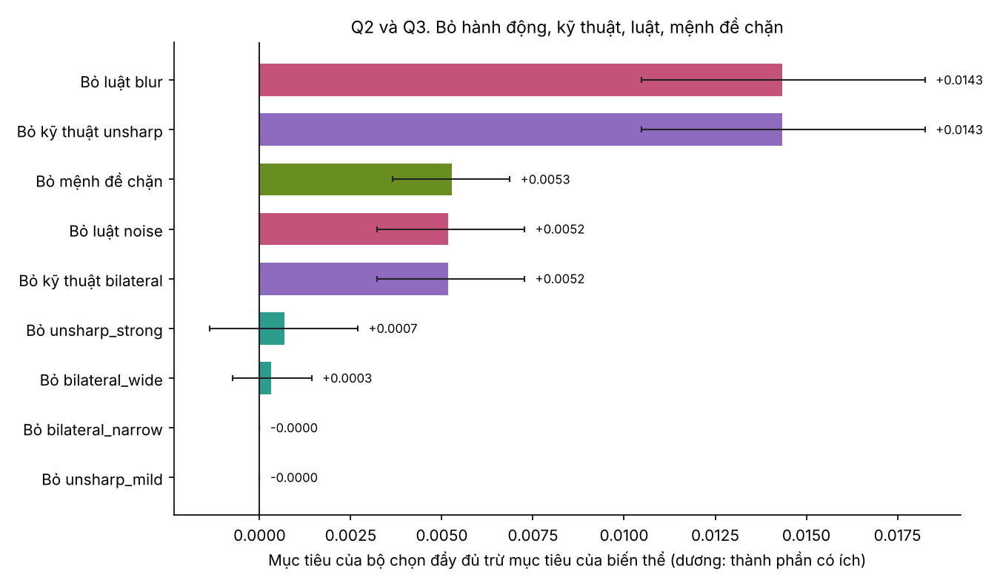
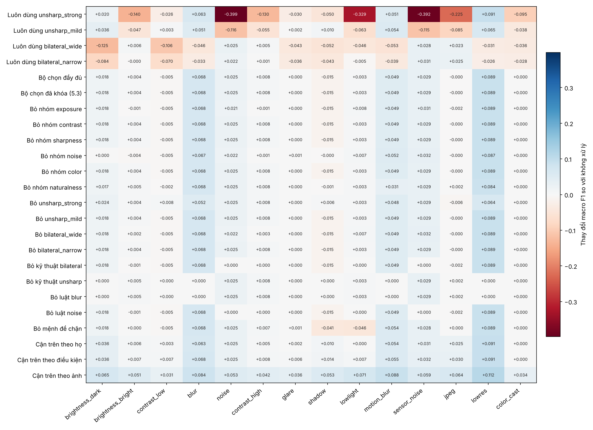

# Kết quả ablation bộ chọn xử lý ảnh, task 5.4

Task này hỏi mức tăng của bộ chọn ở task 5.3 đến từ đâu. Thiết kế và các dự đoán đặt trước nằm ở `docs/task-5.4-selector-ablation.md`.

Mọi số liệu đo trên **tập validation**, 444 ảnh, ảnh sạch và 42 điều kiện suy giảm, với Swin-Tiny đóng băng. Tập test chưa mở. Khoảng tin cậy là 95 phần trăm, bootstrap theo ảnh với 1000 mẫu, ghép cặp giữa các biến thể.

| Nội dung | Vị trí |
|---|---|
| Notebook đã chạy trên Kaggle | https://www.kaggle.com/code/vtnmai/10-selector-ablation/notebook?scriptVersionId=365115435 |
| Notebook trong repo, có log | `notebooks/10_selector_ablation.ipynb`, chạy ở commit `3ce874c` |
| Bảng tổng hợp 25 biến thể | `ablation_summary_val.csv` |
| Macro F1 theo điều kiện của từng biến thể | `ablation_conditions_val.csv` |
| Bộ chọn của từng biến thể | `ablation_selectors.json` |

## Kết luận ngắn

1. **Mức tăng là thật.** Bộ chọn tăng mục tiêu 0.8607 lên 0.8802, tức +0.0195 với khoảng tin cậy từ 0.0152 đến 0.0242. Cross-validation cho +0.0181 ± 0.0044, dương ở 5 trên 5 phần. Bộ chọn hiệu chỉnh lại trên bảng tính mới trùng hoàn toàn bộ đã khóa ở 5.3, và dự đoán `keep` lệch 0.0000 so với task 4.2.
2. **Mức tăng đến từ hai kỹ thuật, và cả hai đều cần.** Luật mờ với unsharp đóng góp 0.0143, luật nhiễu với bilateral đóng góp 0.0052. Cộng lại đúng 0.0195, nên hai phần không chồng lấn.
3. **Không nhóm đặc trưng nào bị chứng minh là không thể thiếu.** Bỏ riêng từng nhóm chỉ mất tối đa 0.0010 và mọi khoảng tin cậy đều chứa 0. Đặc trưng thay thế được cho nhau: bỏ nhóm độ tự nhiên thì luật mờ chuyển sang dùng độ nét và gần như không mất gì.
4. **Proxy BRISQUE không chứng minh được giá trị thêm.** Bỏ nó mất 0.0003, khoảng tin cậy từ -0.0014 đến +0.0018, và cross-validation thậm chí nhỉnh hơn một chút. Báo cáo cuối nên nói thẳng điều này, không nên nói BRISQUE là đóng góp chính.
5. **Mệnh đề chặn có ích rõ ràng.** Bỏ chúng mất 0.0053, ngang cả luật nhiễu, vì khi đó bộ chọn xử lý nhầm ảnh bóng đổ và thiếu sáng.
6. **Hai hành động chưa bao giờ được dùng.** `unsharp_mild` và `bilateral_narrow` bỏ đi mất đúng 0. Chọn giữa các cấu hình cùng kỹ thuật chỉ chênh dưới 0.001, trong vùng nhiễu. Quan trọng là kỹ thuật, không phải cấu hình.
7. **Con số 32 phần trăm so với oracle theo ảnh gây hiểu nhầm.** So với cận trên thực tế hơn thì bộ chọn lấy được 78 phần trăm so với cận theo họ và 71 phần trăm so với cận theo điều kiện. Dư địa còn lại nhỏ, khoảng +0.0055 đến +0.0081, nên không cần làm bản v2 của bộ chọn.

Bộ chọn giữ nguyên như đã khóa ở 5.3.

## Toàn cảnh

Cột là macro F1 trung bình 42 điều kiện, vạch đen là khoảng tin cậy của chính mục tiêu. Đường chấm là không xử lý, đường đứt là bộ chọn đầy đủ. Mọi bộ chọn bỏ một thành phần đều nằm giữa hai đường, nghĩa là không biến thể nào làm hỏng bộ chọn, và hai biến thể tụt xuống gần đường chấm là bỏ luật blur và bỏ kỹ thuật unsharp.

## Q1. Từng nhóm đặc trưng

Mức mất là mục tiêu của bộ chọn đầy đủ trừ mục tiêu của biến thể. Dương nghĩa là nhóm có ích.

| Nhóm bị bỏ | Mức mất | Khoảng tin cậy 95% | Cross-validation | Luật sau khi hiệu chỉnh lại |
|---|---|---|---|---|
| exposure | 0.0008 | -0.0006 đến 0.0023 | 0.0174 ± 0.0048 | Luật nhiễu mất mệnh đề `luma_mean`, đổi thành `noise_sigma` từ 0.0235 trở lên với bilateral_narrow |
| contrast | 0.0000 | không đổi | 0.0181 | Không đổi, không luật nào dùng nhóm này |
| sharpness | 0.0000 | không đổi | 0.0181 | Không đổi, luật mờ đã chọn `mscn_var` thay vì `sharpness` |
| noise | 0.0010 | -0.0005 đến 0.0027 | 0.0181 ± 0.0037 | Luật nhiễu dùng `mscn_var` từ 0.316 trở lên, luật mờ đổi mệnh đề chặn sang `luma_mean` |
| color | 0.0000 | không đổi | 0.0181 | Không đổi, không luật nào dùng nhóm này |
| naturalness | 0.0003 | -0.0014 đến 0.0018 | 0.0184 ± 0.0044 | Luật mờ dùng `sharpness` từ 0.49 trở xuống và `noise_sigma` từ 0.0022 trở xuống |

Bộ chọn đầy đủ có cross-validation 0.0181 ± 0.0044. Ba nhóm cho mức mất đúng 0 là kết quả theo cấu trúc, không phải bằng chứng rằng contrast, sharpness hay color vô dụng. Chúng chỉ không được chọn trong bộ luật này.

Điều đáng chú ý là các đặc trưng thay thế được cho nhau. Độ nét, độ tự nhiên và mức nhiễu cùng đo một mặt của chất lượng ảnh, nên bỏ riêng một nhóm thì nhóm khác nhận việc. Vì vậy kết quả này không nói rằng cả ba cùng thừa. Việc bỏ đồng thời nhiều nhóm chưa được thử.

## Q2 và Q3. Hành động, kỹ thuật, luật, mệnh đề chặn

| Thành phần bị bỏ | Mức mất | Khoảng tin cậy 95% | Điều kiện kém hơn không xử lý |
|---|---|---|---|
| Luật blur, tức chỉ giữ luật noise | 0.0143 | 0.0105 đến 0.0183 | 2 |
| Kỹ thuật unsharp | 0.0143 | 0.0105 đến 0.0183 | 2 |
| Mệnh đề chặn của cả hai luật | 0.0053 | 0.0037 đến 0.0069 | 8 |
| Luật noise, tức chỉ giữ luật blur | 0.0052 | 0.0032 đến 0.0073 | 6 |
| Kỹ thuật bilateral | 0.0052 | 0.0032 đến 0.0073 | 6 |
| Hành động unsharp_strong, thay bằng unsharp_mild | 0.0007 | -0.0014 đến 0.0027 | 4 |
| Hành động bilateral_wide, thay bằng bilateral_narrow | 0.0003 | -0.0007 đến 0.0014 | 6 |
| Hành động bilateral_narrow | 0.0000 | không đổi | 7 |
| Hành động unsharp_mild | 0.0000 | không đổi | 7 |

Bộ chọn đầy đủ có 7 điều kiện kém hơn không xử lý và 25 điều kiện tốt hơn.

- Bỏ luật hay bỏ kỹ thuật cho cùng một con số vì mỗi luật dùng đúng một kỹ thuật.
- Năm hàng đầu đều có khoảng tin cậy không chứa 0, nên các thành phần đó có ích. Bốn hàng cuối đều chứa 0 hoặc bằng 0, nên chưa đủ bằng chứng.
- Biến thể thay unsharp_strong bằng unsharp_mild gần như bằng bộ chọn đầy đủ, với cross-validation 0.0184, và chỉ 4 điều kiện kém hơn không xử lý so với 7. Hiệu này nằm trong nhiễu nên không có lý do đổi bộ đã khóa, nhưng nó cho thấy một hướng an toàn hơn nếu sau này cần.

## Tác động theo họ suy giảm

Mỗi ô là thay đổi macro F1 trung bình ba mức của một họ so với không xử lý. Đọc theo cột để biết thành phần nào chữa họ nào.

- **Họ mà bộ chọn đạt gần cận trên.** blur +0.068, lowres +0.089, motion_blur +0.049, noise +0.025, sensor_noise +0.029, đều sát hoặc bằng cận theo họ.
- **Bỏ mệnh đề chặn gây hại đúng chỗ dự đoán.** shadow từ -0.015 xuống -0.041 và lowlight từ +0.003 xuống -0.046.
- **Hành động cố định gây hại nặng ở họ không phù hợp.** Luôn dùng unsharp_strong làm noise giảm 0.399 và sensor_noise giảm 0.392, đúng với phát hiện ở 4.5.

## Q4. Khoảng cách tới các cận trên

| | Mục tiêu | Tăng so với không xử lý | Bộ chọn lấy được |
|---|---|---|---|
| Không xử lý | 0.8607 | 0 | |
| Hành động cố định tốt nhất, bilateral_narrow | 0.8402 | -0.0204 | |
| **Bộ chọn đầy đủ** | **0.8802** | **+0.0195** | |
| Cận trên theo họ | 0.8857 | +0.0250 | 78% |
| Cận trên theo điều kiện | 0.8883 | +0.0276 | 71% |
| Cận trên theo ảnh | 0.9209 | +0.0602 | 32% |

Ba cận trên đều dùng nhãn nên không triển khai được. Cận theo ảnh lỏng nhất vì chọn hành động đúng cho từng ảnh trong 5 lựa chọn, nên được nâng lên bởi may rủi của dự đoán. Cận theo họ và theo điều kiện chỉ cho chọn một hành động cố định cho cả nhóm ảnh, sát hơn với việc một bộ chọn dựa trên chất lượng ảnh làm được.

Bộ chọn còn kém cận theo họ 0.0055 với khoảng tin cậy từ 0.0020 đến 0.0090, tức nhỏ nhưng khác 0. Phần chênh nằm ở ba họ:

| Họ | Bộ chọn | Cận theo họ | Ghi chú |
|---|---|---|---|
| jpeg | -0.000 | +0.025 | Bilateral cố định tăng 0.023 đến 0.025, nhưng bộ đặc trưng hiện tại không có đặc trưng đo vết nén JPEG nên bộ chọn không kích hoạt |
| shadow | -0.015 | +0.010 | Luật mờ bắt nhầm ảnh bóng đổ, lỗi đã biết từ 5.3 |
| brightness_dark | +0.018 | +0.036 | Một phần mức tăng hiện có là may mắn như đã ghi ở 5.3 |

Mỗi họ có 3 trong 42 điều kiện, nên cả ba họ cộng lại chỉ đáng khoảng 0.005 trên mục tiêu. Đây là lý do không nên tinh chỉnh bộ chọn thêm.

## Đối chiếu dự đoán đặt trước

| # | Dự đoán | Kết quả |
|---|---|---|
| 1 | Nhóm color và contrast mất đúng 0 | **Đúng.** Nhóm sharpness cũng mất đúng 0, điều chưa dự đoán |
| 2 | Nhóm naturalness mất nhiều nhất, tối thiểu 0.005 | **Sai.** Chỉ mất 0.0003, khoảng tin cậy chứa 0. Độ nét thay thế được. Nhóm mất nhiều nhất là noise với 0.0010, cũng chưa đủ bằng chứng |
| 3 | Bỏ unsharp mất nhiều hơn bỏ bilateral, gần 0.014 | **Đúng.** 0.0143 so với 0.0052 |
| 4 | Bỏ mệnh đề chặn làm giảm mục tiêu | **Đúng.** Mất 0.0053. Rủi ro trên ảnh sạch không đổi vì F1 sạch vẫn 0.9664 |
| 5 | Phần bộ chọn lấy được cao hơn rõ rệt khi so với cận theo họ hoặc điều kiện | **Đúng.** 78% và 71% so với 32% |

Dự đoán sai được giữ nguyên như đã viết.

## Giới hạn

- Mọi số đo trên validation, nơi ngưỡng đã hiệu chỉnh. Biến thể hiệu chỉnh lại cũng được tối ưu trên chính validation, nên mức mất của chúng có thể bị đánh giá thấp. Đánh giá trên test ở task 6.1 mới là bằng chứng cuối.
- Bootstrap chỉ lấy lại mẫu ảnh, giữ nguyên 42 điều kiện của benchmark. Khoảng tin cậy không bao gồm sự thay đổi của loại suy giảm.
- Các họ suy giảm vẫn là 14 họ đã thấy. Tổng quát hóa sang họ chưa thấy đo ở task 5.5.
- Mỗi lần bỏ một thành phần rồi hiệu chỉnh lại, bộ chọn có thể bù bằng thành phần khác, nên đây là mức mất sau thích nghi. Hai hàng không hiệu chỉnh lại đo mức mất không thích nghi.
- Biến thể bỏ mệnh đề chặn bỏ cả hai mệnh đề cùng lúc, chưa tách xem mệnh đề nào quan trọng hơn.
- Nhóm độ tự nhiên là phương sai MSCN, một proxy của BRISQUE. Kết luận chỉ áp dụng cho proxy này.
- Hình trong thư mục này được vẽ lại từ file CSV của lần chạy, chỉ sửa nhãn và vị trí chữ cho dễ đọc. Hai biến thể chỉ giữ một luật có nhãn mới là bỏ luật còn lại, vì cột mất mục tiêu đo đúng điều đó. Log và hình gốc vẫn nằm trong notebook. Hình `ablation_tradeoff.png` của notebook không đưa vào đây vì mọi biến thể chọn lọc đều không làm đổi dự đoán ảnh sạch, nên chỉ còn các hành động cố định nằm tách ra.
