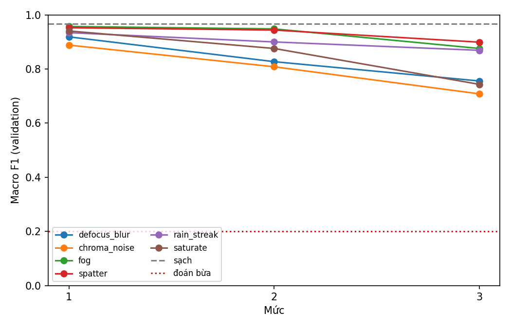
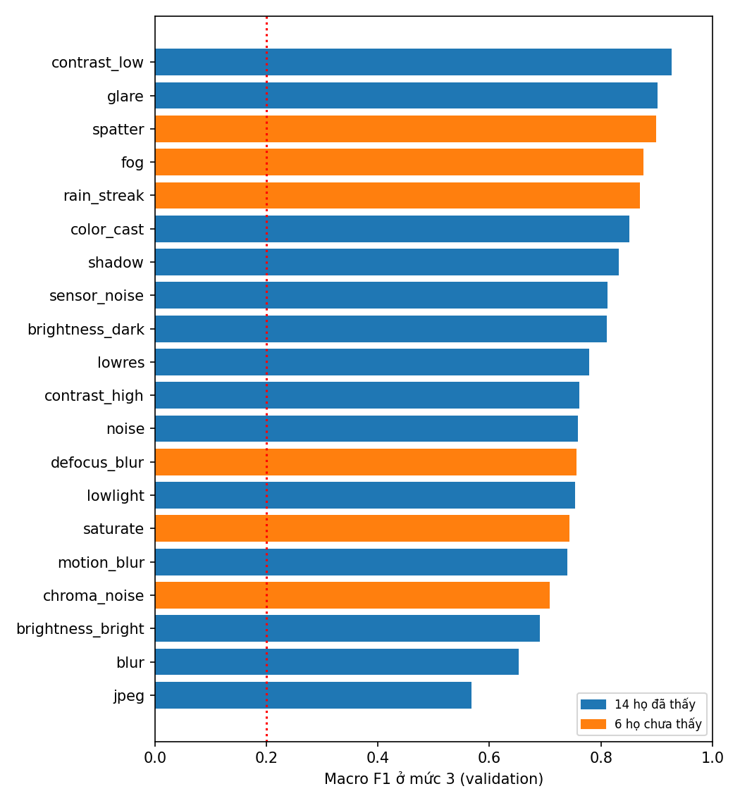
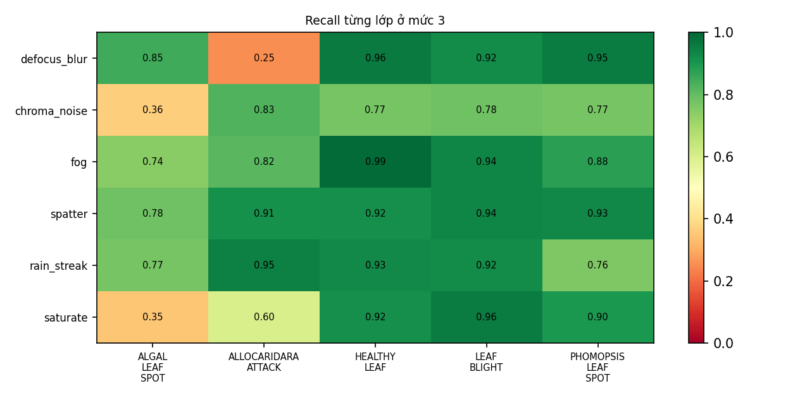

# Kết quả hiệu chỉnh bộ họ chưa thấy, task 5.5

Task này dựng 6 họ suy giảm không có trong 14 họ của benchmark 4.1, chỉ để đánh giá, rồi chọn ba mức cho mỗi họ trên validation. Thiết kế nằm ở `docs/task-5.5-unseen-families.md`, cấu hình ở `configs/unseen_corruption.yaml`.

Mọi số liệu đo trên **tập validation**, 444 ảnh, với Swin-Tiny đóng băng, không train lại. Tập test chưa mở. Các mức đã **khóa** ở file cấu hình.

| Nội dung | Vị trí |
|---|---|
| Notebook đã chạy trên Kaggle | https://www.kaggle.com/code/vtnmai/11-unseen-corruption-calibration/notebook?scriptVersionId=365130068 |
| Notebook trong repo, có log | `notebooks/11_unseen_corruption_calibration.ipynb`, chạy ở commit `7026e32` |
| Điểm từng điều kiện và recall từng lớp | `validation_calibration.json` |

## Kết luận ngắn

1. **Cả 6 họ đạt kiểm tra mức tự động.** Điểm giảm dần theo mức ở mọi họ, mức 1 không làm sụp điểm, mức 3 không quá nhẹ và không gần mức đoán bừa. Mức được khóa.
2. **Bộ chưa thấy không khó hơn bộ đã thấy.** Macro F1 mức 3 trung bình là 0.809 so với 0.774 của 14 họ, ảnh sạch là 0.966, đoán bừa là 0.2. Nhóm gần khó hơn nhóm xa, 0.732 so với 0.847.
3. **Ba họ xa nhẹ ở mức 3.** fog, spatter và rain_streak chỉ làm mất 0.07 đến 0.10 điểm. Đây là lựa chọn có chủ đích để ảnh vẫn nhận ra được bệnh, nhưng khi so sánh các phương pháp ở 6.1 thì ba họ này sẽ ít phân biệt được chúng.
4. **Mỗi họ làm hỏng một lớp khác nhau.** Nhìn recall từng lớp ở mức 3 sẽ thấy defocus_blur làm sụp ALLOCARIDARA_ATTACK, còn chroma_noise và saturate làm sụp ALGAL_LEAF_SPOT. Bộ này vì vậy đo được những điểm yếu mà 14 họ cũ chưa chạm tới.

## Mức đã khóa và điểm trên validation

Macro F1 của ảnh sạch là 0.966.

| Họ | Nhóm | Ba mức | Mức 1 | Mức 2 | Mức 3 | Mất ở mức 3 |
|---|---|---|---|---|---|---|
| defocus_blur | gần | 1.0, 1.8, 2.5 | 0.919 | 0.827 | 0.756 | 0.211 |
| chroma_noise | gần | 0.03, 0.05, 0.07 | 0.889 | 0.808 | 0.708 | 0.258 |
| fog | xa | 0.30, 0.55, 0.85 | 0.957 | 0.948 | 0.876 | 0.090 |
| spatter | xa | 0.10, 0.25, 0.40 | 0.953 | 0.944 | 0.899 | 0.067 |
| rain_streak | xa | 0.001, 0.003, 0.005 | 0.934 | 0.900 | 0.869 | 0.097 |
| saturate | xa | 1.4, 2.0, 3.0 | 0.941 | 0.876 | 0.743 | 0.223 |

Các cờ kiểm tra gồm điểm tăng theo mức, mức 1 mất từ 0.4 trở lên, mức 3 mất dưới 0.03 và mức 3 chỉ cao hơn đoán bừa dưới 0.1. Không họ nào bị gắn cờ. Ngưỡng nằm ở `src/evaluation/calibration_report.py`.

## Ảnh mẫu

Ba ảnh validation thuộc ba lớp, cột đầu là ảnh sạch, ba cột sau là mức 1, 2, 3.

- `severity_examples_healthy_leaf.jpg`
- `severity_examples_leaf_blight.jpg`
- `severity_examples_algal_leaf_spot.jpg`
- `severity_examples_preview.jpg` là ảnh xem trước có vết cháy rõ, cắt từ ảnh minh họa lớp ở báo cáo chất lượng dữ liệu, không do notebook này sinh ra.

Nhận xét khi xem ảnh:

- **Ảnh xem trước có vết cháy rõ.** Vết còn thấy ở mức 3 của mọi họ, mờ nhất ở fog 0.85.
- **Trong hai ảnh LEAF_BLIGHT và ALGAL_LEAF_SPOT vết bệnh rất nhỏ**, nên mắt khó xác nhận ở độ phân giải 224. Với hai ảnh này, nhận xét dựa vào điểm của model, không dựa vào mắt.
- **fog 0.85** làm ảnh rất nhạt, nhưng hình dạng lá vẫn nhận ra.
- **chroma_noise 0.07** thấy hạt màu rõ trên cả lá, đây là mức mạnh nhất đã chọn.
- **saturate 3.0** cho màu xanh chói và xanh lơ ít gặp khi chụp thật. Nên coi đây là phép thử độ nhạy với màu, không phải ảnh chụp ngoài vườn.
- **spatter 0.4** tạo các mảng nhòe nhạt, giống giọt nước trên ống kính ở mức vừa.
- **rain_streak 0.005** thấy vệt sáng mảnh nghiêng, rõ nhưng không che hẳn lá.

## Đường cong theo mức

Mỗi đường là một họ, đường đứt là ảnh sạch, đường chấm đỏ là mức đoán bừa. Mọi đường đi xuống đều và mức 3 còn cách mức đoán bừa xa.

## So với 14 họ đã thấy

Các họ chưa thấy nằm lẫn vào giữa các họ đã thấy. Họ khó nhất vẫn là jpeg của bộ cũ, 0.568. defocus_blur, saturate và chroma_noise nằm cạnh nhóm khó trung bình gồm noise, lowlight và motion_blur. fog, spatter, rain_streak nằm ở nhóm dễ.

## Recall từng lớp ở mức 3

| Họ | Lớp yếu nhất | Recall |
|---|---|---|
| defocus_blur | ALLOCARIDARA_ATTACK | 0.25, từ 0.78 ở mức 1 |
| chroma_noise | ALGAL_LEAF_SPOT | 0.36 |
| saturate | ALGAL_LEAF_SPOT | 0.35 |
| fog | ALGAL_LEAF_SPOT | 0.74 |
| spatter | ALGAL_LEAF_SPOT | 0.78 |
| rain_streak | PHOMOPSIS_LEAF_SPOT | 0.76 |

Hai kiểu sụp rõ nhất:

- **Mờ làm mất ALLOCARIDARA_ATTACK.** Lớp này có tổn thương nhỏ, nên khi mất chi tiết thì model không còn nhận ra.
- **Nhiễu màu và quá bão hòa làm mất ALGAL_LEAF_SPOT.** Lớp này phụ thuộc màu nhiều hơn các lớp khác.

Lớp HEALTHY_LEAF và LEAF_BLIGHT giữ recall trên 0.77 ở mọi họ.

## Kỳ vọng cho task 6.1

Các kỳ vọng dưới đây viết **trước khi mở test**, dựa trên cơ chế của bộ chọn đã khóa. Bộ chọn chưa được chạy trên các họ này, kể cả trên validation.

1. **defocus_blur:** luật mờ kích hoạt nên bộ chọn tăng điểm, nhưng ít hơn mức tăng +0.068 của blur Gauss, vì unsharp được hiệu chỉnh cho mờ Gauss.
2. **chroma_noise:** bộ chọn gần như không kích hoạt, vì đặc trưng nhiễu đo trên độ sáng mà họ này giữ nguyên độ sáng. Kỳ vọng mức tăng gần 0.
3. **saturate và spatter:** không hành động nào trong tập hiện có nhắm vào chúng, kỳ vọng mức tăng gần 0.
4. **fog:** có nguy cơ làm hại. Fog làm tương phản thấp nên `mscn_var` thấp, có thể kích hoạt luật mờ nhầm như đã thấy ở contrast_low và shadow.
5. **Chung:** mức tăng của bộ chọn trên bộ chưa thấy nhỏ hơn +0.0195 đo trên validation ở các họ đã thấy.

Kỳ vọng sai cũng được ghi lại như kết quả.

## Giới hạn

- Mức được chọn bằng chính Swin-Tiny, nên khó vừa nghĩa là khó với model này. Model khác có thể thấy khác.
- Chỉ sáu họ và 444 ảnh. Recall của lớp nhỏ biến động nhiều, ALLOCARIDARA_ATTACK chỉ có 46 ảnh, nên một ảnh đổi dự đoán làm recall lệch hơn 0.02.
- fog và spatter dùng trường ngẫu nhiên giả, không dựng từ ảnh có sương hay giọt nước thật.
- saturate ở mức 3 chưa giống ảnh thật, xem phần ảnh mẫu.
- Ba họ xa nhẹ ở mức 3. Nếu cần bộ khó hơn thì phải đổi mức, nhưng việc đó chỉ làm được trước khi mở test.
- Các ảnh mẫu trong thư mục này đã nén sang JPEG để nhẹ repo. Trong notebook đã chạy, ba ảnh mẫu cũng được nén tương tự. Ảnh PNG gốc nằm trong output Kaggle.
